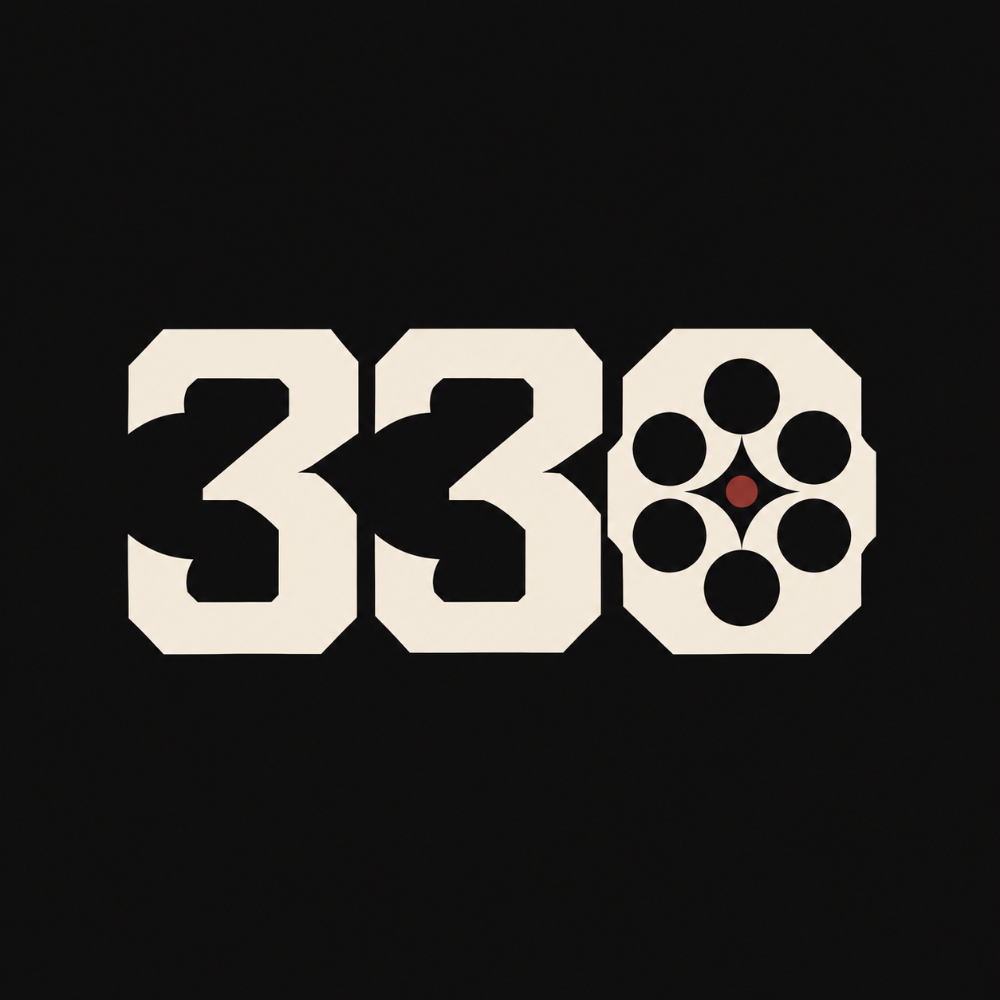

<p align="center"></p>
<h1 align="center">330 Stables for VORP</h1>
<p align="center">Horses, tack and wagons for your RedM server.</p>
<p align="center"><strong>Free · First public beta · English / Czech</strong></p>

> **Beta testers wanted.** Try this on a staging copy of your server and tell us what works and what breaks. Back up your database before replacing an existing stable. This is for **RedM**, not FiveM/GTA V.

[Download](https://github.com/editlxrd/330-stables-for-vorp/releases) · [Install](docs/INSTALLATION.md) · [Migrate](docs/MIGRATION.md) · [Configure](docs/CONFIGURATION.md) · [Report a bug](https://github.com/editlxrd/330-stables-for-vorp/issues/new/choose)

## Features

- **Real 3D previews:** browse horses, coats, tack and wagons; rotate the selected model. Previews are local to the browsing player; called owned rides are networked.
- **My Stable:** name horses/wagons, select an active ride, and see its real name and Active badge.
- **Call and dismiss:** H calls your horse with your VORP character's whistle; J calls your wagon. F dismisses your owned wagon when targeting it or its draft horse. Horse Flee is also available.
- **Lead your horse:** E starts/stops native leading on your owned riding horse. The prompt follows the actual game state. Harnessed draft/wagon leading is disabled by default after a live native-task rejection.
- **Own your tack:** buy a variant once and equip it again without another payment. Each horse keeps its fitted components; owned/equipped indicators show what you already have.
- **Cash and gold:** choose the payment beside the wallet. Prices, conversion and exact gold overrides are set by the server. Both currencies use the VORP Core character wallet.
- **Sell wagons back:** default payout is **60%** of the recorded purchase price, in the originally paid currency. The percentage is configurable; legacy receipts fall back to the catalogue price.
- **Sell horses/wagons to other players:** enter the online buyer's server ID and agreed cash price. They receive an **offer request** and open **My Stable → Incoming offers** to accept or decline. Ownership and payment change only after acceptance. Both players must be online and nearby; the recipient must be at a stable. A price of zero is a gift.
- **Individual storage:** owned database-row IDs give each ride its own storage identity, including identical models. Inventory adapter and old-bag migration limitations are explained below.
- **Polished menu:** loading progress, smooth category/variant transitions, pressed-key feedback, custom dropdowns, notifications and reduced-motion support. English/Czech locales are editable.
- **Server-owner options:** per-stable shop lists/prices, capacities, jobs, payments, blips, NPCs, cameras, thumbnails, storage limits and streaming settings. No frontend build required.

## Locations

| Stable | Entrance X, Y, Z |
|---|---|
| Valentine | -365.87, 789.51, 116.17 |
| Rhodes | 1432.97, -1295.39, 76.82 |
| Wapiti | 482.06, 2215.17, 247.16 |
| Saint Denis | 2510.58, -1456.83, 46.31 |
| Strawberry | -1816.81, -561.99, 156.07 |
| Blackwater | -876.57, -1365.10, 43.53 |
| Tumbleweed | -5514.24, -3041.81, -2.39 |
| Colter | -1334.20, 2397.41, 307.21 |
| Van Horn | 2968.86, 792.97, 51.40 |
| Emerald Ranch | 1393.46, 353.09, 87.63 |
| Scarlett Meadows | 1211.55, -190.84, 101.39 |

Blips/NPCs are configurable. The four additional sites—Colter, Van Horn, Emerald Ranch and Scarlett Meadows—need camera/spawn-clearance acceptance with your map/IPLs. An IPL loader is separate and is not bundled.

## Requirements and quick install

**RedM server, OneSync, VORP Core, oxmysql and a compatible inventory.** Development used VORP Core 3.3 and the VORP Stables 1.3 ownership schema. Native VORP Inventory and 330 Inventory adapters are included; full Inventory V2 storage acceptance on every version is not certified.

1. Download the **install ZIP from Releases**.
2. Back up your database and old resource; disconnect players for replacement.
3. Copy `vorp_stables` into resources. Keep this exact folder name; run only one implementation.
4. Configure `config.lua`, start dependencies, then start the stable.

```cfg
ensure oxmysql
ensure vorp_core
ensure vorp_inventory
ensure vorp_stables
```

Existing supported VORP `stables` / `horse_complements` rows are reused. **Never import the upstream SQL containing DROP TABLE over existing data.** Included schema creation is additive. Follow [MIGRATION.md](docs/MIGRATION.md) for old brašna/saddlebag contents and rollback.

## Configuration preview

These are excerpts inside the existing Config table, not a second config file:

```lua
Locale = 'en',                 -- 'en' / 'cs'
MaxHorses = 3,
MaxCarts = 1,
StableSlots = 4,
ShowBlips = true,
SpawnNPCs = true,
EnableLeading = true,
EnableDraftLeading = false,    -- experimental; tested harnessed team refused it
HorseCallDistance = 35.0,
WagonSellPercent = 60,
Payments = {
    GoldEnabled = true,
    CashPerGold = 25,          -- choose your own economy rate
    GoldPrices = { A_C_Horse_AmericanStandardbred_Black = 4 },
},
PreviewCamera = { HorsesUseWagonSpot = true, HorseFov = 28.0, WagonFov = 60.0 },
```

[Config explained](docs/CONFIGURATION.md) · [Add models/tack/images](docs/CATALOGUE.md) · [Český návod](docs/RYCHLY-START-CS.md)

## Beta limitations

### Planned next

Horse needs/status (hunger, thirst, stamina), horse care/service and brushing, breeding, aging, full VORP Inventory acceptance and a more complete wagon-storage flow are on the [roadmap](ROADMAP.md). Initial inventory adapters/per-ride storage identities already exist; this does not mean every version or old-bag migration is certified. These are future directions, not all included features.

- Riding-horse Lead and wagon Dismiss are player-tested. **Wagon/draft leading is not supported by default.**
- Old model/character custom-inventory contents are **not automatically copied** into new per-ride bags. Ownership reuse and inventory-content migration are different operations.
- Native VORP Inventory V2 storage, every map/game build and third-party stable-event contract are not universally certified. Unverifiable/non-empty storage blocks permanent sale/release.
- Core wallet and SQL ownership changes are not one crash-atomic transaction. Refunds cover normal failures/disconnects; a process crash may need administrative reconciliation.
- Upstream breeding, professions and permanent-death systems are not ported. RSG and unrelated ownership schemas are not advertised as drop-in supported.
- Native previews, spawn clearance and performance depend on your server/game environment. No universal FPS or resource-monitor figure is claimed.

## Documentation and feedback

| Guide | What it covers |
|---|---|
| [Installation](docs/INSTALLATION.md) | Folder, start order, updates |
| [Migration](docs/MIGRATION.md) | Read-only preflight, existing data, bags, rollback |
| [Configuration](docs/CONFIGURATION.md) | Settings and payment examples |
| [Catalogue / developer guide](docs/CATALOGUE.md) | Models, tack, thumbnails, exports |
| [Testing](docs/TESTING.md) | Evidence and staging checklist |
| [Troubleshooting](docs/TROUBLESHOOTING.md) | Prompts, loading, storage, errors |

Report problems through [GitHub Issues](https://github.com/editlxrd/330-stables-for-vorp/issues/new/choose). Include versions, reproduction steps and **redacted** F8/server errors. Never post passwords, tokens, keys, player identifiers or your entire server.cfg. Exploits go through [private security reporting](SECURITY.md).

Free beta, best-effort maintenance: reports and pull requests are welcome; response times, lifetime support and custom integrations are not promised.

## Screenshots, licence and credits

Real gameplay screenshots will be added after capture. See [MEDIA.md](docs/MEDIA.md); no browser mockup is presented as evidence of native rendering.

Approximately **4,400 distributed runtime lines**, including Lua/config/catalogues and the minified UI build (roughly 7,500 lines before UI compilation). No Node/React/Python runtime dependency.

Lua/backend code is MIT licensed; the compiled UI and 330 branding are reserved to 330 (see UI-LICENSE.md). Adapted VORP data retains attribution; fonts and illustrations have separate OFL/CC0/GPL notices. See [THIRD-PARTY-NOTICES.md](THIRD-PARTY-NOTICES.md). The code licence does not relicense those assets. 330 is not affiliated with Rockstar Games, Cfx.re or VORP.
